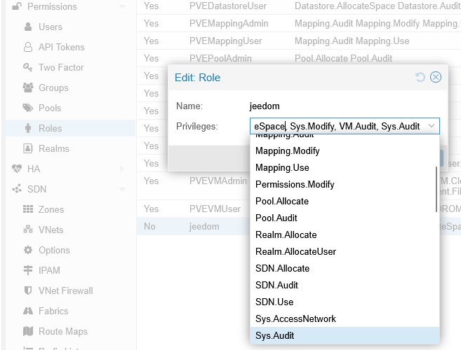
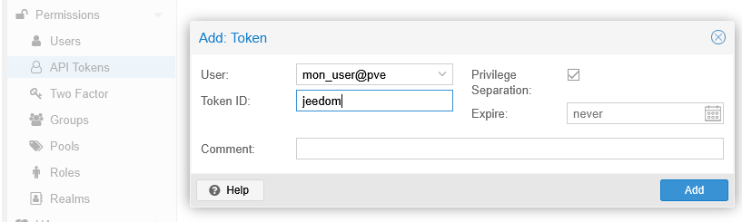
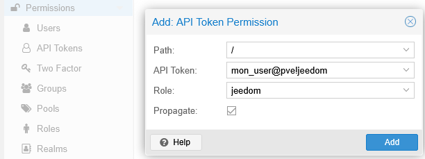
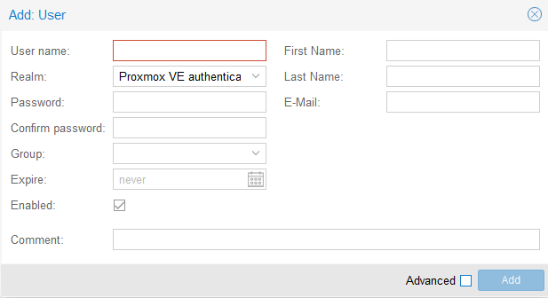
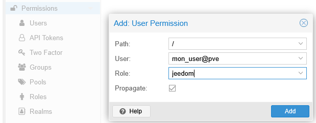
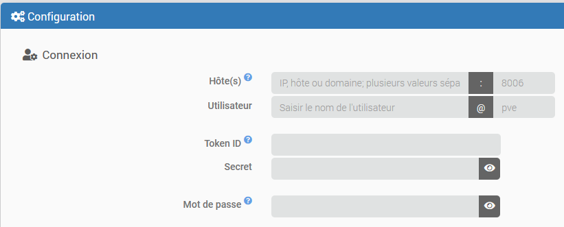
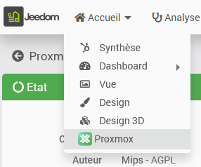
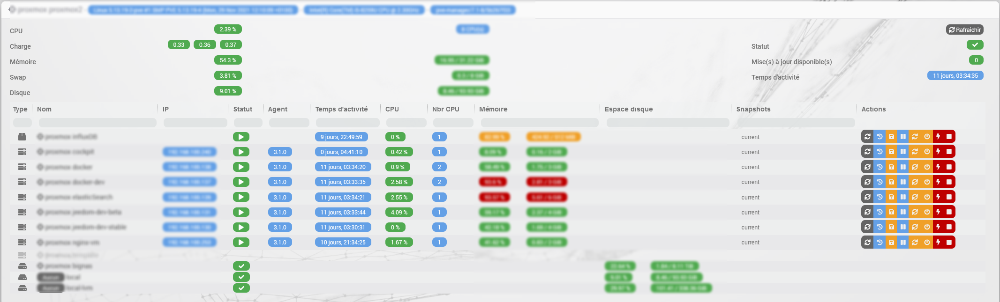

# Description

Plugin for managing a Proxmox server (a node) or a Proxmox cluster (multiple nodes in the same cluster)—in other words, **one and only one** Proxmox *datacenter*.
It is possible to retrieve all resources (nodes, VMs, storage, etc.) and all their properties (status, memory, CPU, disk, IP address, uptime, list of snapshots, etc.)
The plugin also allows you to start and stop VMs and containers, as well as take snapshots and backups.
It also features a dedicated health page that summarizes all the information about your devices.

# Supported Versions

| Component | Version |
|-----------|---------------------------|
| Debian    | Bookworm (12) & Trixie (13) |
| Jeedom    | >= 4.5 |
| PHP | >= 8.2 |
| Proxmox   | >= 9.2 |

# Installation

To use the plugin, you must download, install, and activate it just like any other Jeedom plugin.

# Proxmox Configuration

The Proxmox account you use must have access to the resources you want to monitor. Creating accounts and setting permissions is not described in detail here; see the official Proxmox documentation for more information.

This configuration is done on the "datacenter" in the Proxmox interface, under the "Permissions" menu

## Permission Assignment

The user or token used by Jeedom must have the necessary permissions for the features you want to use.

It is not recommended to assign the "Administrator" role to the user or token used by Jeedom. The minimum privileges required for all plugin features to function are as follows:

| Privileges | Node: Info | Node: Actions | VM & LXC: Info | VM & LXC: Actions | VM & LXC: Backup & Snapshot | Storage: Info |
|-------------------------|--------------|----------------|-----------------|-------------------|-----------------------------|-----------------|
| Datastore.Allocate | | | | | required | |
| Datastore.AllocateSpace | | | | | required | |
| Datastore.Audit | | | | | required | required |
| Sys.Audit | required | required | | | | |
| Sys.Modify | | required | | | | |
| Sys.PowerMgmt | | required | | | | |
| VM.Audit | | | required | required | | |
| VM.Backup | | | | | required | |
| VM.PowerMgmt | | | | required | | |
| VM.Snapshot | | | | | required | |

To limit access to only what is strictly necessary, create a custom role in "Permissions" > "Roles," then grant it the privileges listed above. Depending on the authentication mode you choose, you will assign this role to the user, or to the owner user and the API token.

Example:\

You can find more information here: <https://pve.proxmox.com/wiki/User_Management>

## Authentication Modes

The plugin offers two authentication modes: via API token or password.

> **Tip**
>
> The recommended mode of authentication is the API token with privilege separation enabled. Authentication via username and password is still possible. In both cases, it is recommended to create a custom role limited to the privileges required by the plugin, as listed in the table above.

### Token API

This mode is recommended. Create a token for the Proxmox user of your choice in that user's token management settings. Leave "Separation of Privileges" enabled so that the token's permissions can be managed independently. Please note that the token remains limited by its owner's permissions.

> **Tip**
>
> In this mode, it is acceptable to create the token for the `root@pam` user if you have strictly limited the token's access to what is strictly necessary for your use within the plugin.

Example:\

When you create it, Proxmox displays the token secret only once. Copy it immediately so you can enter it in Jeedom.\
In the plugin, enter the owner's username in "User," their realm in "Realm," the token ID in "Token ID," and the secret displayed by Proxmox in "Secret."

> **Attention**
>
> Proxmox sometimes uses the terms “Token ID” and “Token name” interchangeably: they can refer to the name chosen for the token (for example, `jeedom`) or its full technical identifier, in the format `[USER]@[REALM]![TOKEN_NAME]`. In the “Token ID” field in Jeedom, enter only the chosen name, for example `jeedom`.

In "Permissions," verify that the user who owns the token has permissions at least equivalent to those of the custom role (the user may be an administrator). Then add a permission for the token itself and assign it the role you created earlier. With privilege separation enabled, the token's actual permissions are the intersection of the owner's permissions and the token's permissions.

See the Proxmox documentation on [API tokens](https://pve.proxmox.com/pve-docs/pve-admin-guide.html#pveum_tokens) and [permission management](https://pve.proxmox.com/pve-docs/pve-admin-guide.html#pveum_permission_management) for details and the effects of privilege separation.

### Username and password

If you choose password authentication, create a Proxmox account for Jeedom under "Permissions" > "Users." We recommend using a dedicated account with a password reserved for this purpose.

When creating the account, select the "Proxmox VE authentication server" realm to set the password in Proxmox:

Save the username, realm, and password to enter them in the plugin's configuration. Do not enable two-factor authentication (2FA) for this account: it is not supported by the plugin's password-based authentication mode.

In the "Permissions" main menu, click "Add" and then "User permission" to assign a role (see the Proxmox documentation for more details):

# Plugin configuration

You must enter the following information in the plugin's configuration:

- Hostname, domain, or IP address of your server (or one of the nodes in the cluster if you have multiple). You can configure a comma-separated list of values for each node **in the same cluster or data center**; for example: `pve1,pve2,192.168.0.100,192.168.0.200`
- a port that is different from the default port (8006)
- a username and its authentication realm, which is different from "pve" (="Proxmox VE authentication server," the default realm for users created locally on Proxmox)
- the Token ID and secret (recommended mode),
- or the Proxmox user password

If both the Token ID and Secret are entered, the plugin uses the token, even if a password is also configured. To use the password, clear both token fields. An incomplete token is not used.

You can define tags to include or exclude in order to filter new virtual machines and containers created in Jeedom. If tags are configured for inclusion, only resources bearing at least one of these tags will be created. A resource bearing an excluded tag will not be created.

You can also choose the default parent object to which the devices will be linked so that you don't have to move them later. The plugin will not assign them if a device with the same name already exists in that object.

You can now adjust the refresh interval for information, which defaults to 30 seconds.

Save the configuration after each change before starting the daemon. If your configuration is correct, its status will remain "OK."

You can also enable the dashboard panel, which will be accessible via the *Home* menu:\

# Panel

The dashboard is very comprehensive, offering a complete overview of all Proxmox resources (containers, virtual machines, and storage spaces) organized by nodes. You can perform all actions on the VMs directly from the dashboard, and the information is updated in real time.

# How the plugin works

Once the plugin configuration is complete, the daemon should start and attempt to connect to Proxmox at the configured interval to synchronize the information.

All devices accessible to the plugin will be automatically created in Jeedom and enabled; it is not possible to create a device manually. Device names cannot be changed in Jeedom; they will always match the names in Proxmox. A device will never be automatically deleted, but it will be disabled.

You can perform a manual synchronization using the button on the devices page.

When an action is performed (such as taking a snapshot or restarting a machine), the status of the device will also be automatically updated.

# Available commands

## Nodes

These devices have several status commands that provide information on uptime, CPU, disk, and memory usage, as well as information on the number and type of CPUs and the kernel version in use.
The following action commands are also available:

- **Restart the node**: Shuts down all VMs and restarts the node
- **Shut down the node**: Shuts down all VMSs and the node
- **Start All**: Starts all machines and containers that have the "Autostart" option enabled
- **Shut Everything Down**: Shuts down all virtual machines and containers

## Virtual Machines & Containers

There are several info commands that provide, among other things, the system status, the number of CPUs and their usage, total memory and memory usage, uptime, and IPv4 and IPv6 addresses.

> **Tip**
>
> To track IP addresses, you need to install the Proxmox agent on the VMs and enable it (see the Proxmox documentation). This agent will also ensure that your VM remains stable during backups and snapshots.

The following action commands are also available:

- **Start**: Starts the virtual machine or container.
- **Stop**: This triggers a clean shutdown of the virtual machine or container.
- **Shut Down Immediately**: This immediately and abruptly shuts down the virtual machine or container, which may result in data corruption.
- **Pause**: Pauses the virtual machine or container
- **Resume**: Restarts the virtual machine or container after it has been suspended
- **Snapshot**: Allows you to take a snapshot; you can provide a name for the snapshot (optional) and a description (also optional). The name must consist solely of letters, numbers, and the underscore (_) character, and must begin with a letter. If no name is provided or if the name is invalid, the plugin will generate a random name. For VMs, you can also choose whether or not to include RAM when using this command in a scenario.
- **Backup**: allows you to create a backup. This command (of the "message" type) has an 'email' field that can contain an email address to which a notification will be sent once the backup is complete (email sent by your Proxmox server) and an 'Options' field in which you must specify each desired option in the format *option=value* (use a space to separate multiple options; see the table below for a list of available options); example: `mode=snapshot compress=zstd mailnotification=failure`

| Name | Description | Format | Default value |
|------------------|------------------------------------------------------------------------------------------------------------------------------------|-----------------------------------------------------------------------------------------------------------------------------------------------------------------|----------------------------------------------------------------------|
| storage | Backup location | Name of the storage resource that must be configured for the 'backup' type and have the 'available' status. Be sure to use the correct case. | By default, the first storage resource that meets the criteria is used. |
| mode | Backup mode | possible values are: `snapshot`, `suspend`, `stop` | `snapshot` |
| compress | Backup compression | Possible values are: `0`, `gzip`, `lzo`, `zstd` | `lzo` |
| mailnotification | Specifies when to send a notification | Possible values are: `always`, `failure` | `always` |
| remove | Deletes old backups if there are more than the maximum number configured for the selected storage (see Proxmox configuration) | possible values are: `0`, `1` | `1` |

## Storage

Info commands provide disk usage and device status.

It is also possible to view the type of content it contains (backups, ISO files, VM disks, etc.); this information is useful when using the "Backup" command for virtual machines.

# Change log

[View the changelog](./changelog)

# Support

If you're having a problem, start by reading the latest threads related to the plugin on [community]({{site.forum}}/tag/plugin-{{page.pluginId}}).

If you still can't find an answer to your question, feel free to create a new thread—and don't forget to include the plugin tag ([plugin-{{page.pluginId}}]({{site.forum}}/tag/plugin-{{page.pluginId}})).

At a minimum, you must provide:

- a screenshot of the Jeedom Health page
- a screenshot of the plugin's settings page
- All available plugin logs at the *INFO* level, pasted into `Preformatted Text` (use the `</>` button on the community), no files!
- Depending on the situation, a screenshot of the error encountered, a screenshot of the problematic configuration...
