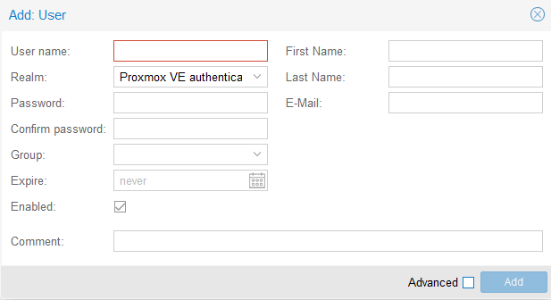
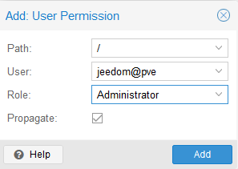
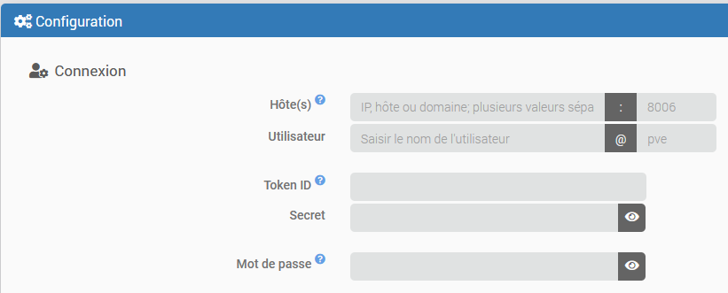
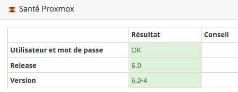
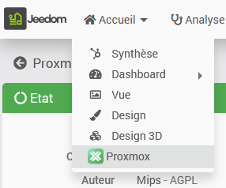
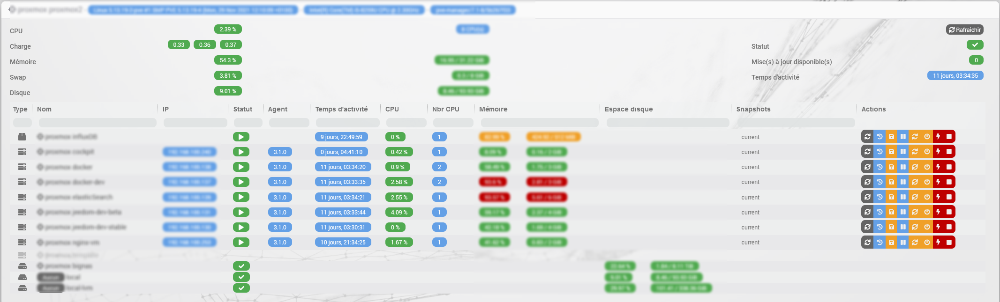

# Description

Plugin permettant la gestion d'un serveur (un noeud) Proxmox ou d'un cluster (plusieurs noeuds dans le même cluster) Proxmox, autrement dit **un et un seul** *datacenter* Proxmox.
Il est possible de récupérer toutes les ressources (noeuds, vms, stockage...) et toutes leurs propriétés (statut, mémoire, CPU, disque, adresse IP, temps d'activité, list des snapshots...)
Le plugin permet aussi de démarrer et arrêter les VMs et les containers ainsi que de prendre des snapshots et des backups.
Il dispose également d'une page santé spécifique résumant l'ensemble des informations de vos équipements.

# Versions supportées

| Composant | Version                   |
|-----------|---------------------------|
| Debian    | Bookworm(12) & Trixie(13) |
| Jeedom    | >= 4.5                    |
| PHP       | >= 8.2                    |
| Proxmox   | >= 9.2                    |

# Installation

Afin d’utiliser le plugin, vous devez le télécharger, l’installer et l’activer comme tout plugin Jeedom.

# Configuration de Proxmox

Le compte Proxmox utilisé doit pouvoir accéder aux ressources que vous souhaitez surveiller. La création des comptes et des permissions n'est pas décrite en détail ici; consultez la documentation officielle de Proxmox pour plus d'informations.

Cette configuration se fait sur le "datacenter" dans l'interface de Proxmox, menu "Permissions"

## Attribution des permissions

L'utilisateur ou le token utilisé par Jeedom doit disposer des permissions nécessaires aux fonctions que vous souhaitez utiliser.

Il n'est pas recommandé de donner le rôle "Administrator" à l'utilisateur ou au token utilisé par Jeedom. Les privilèges minimum requis pour que toutes les fonctions du plugin fonctionnent sont les suivants:

| Privilèges              | Noeud: infos | Noeud: actions | VM & LXC: infos | VM & LXC: actions | VM & LXC: backup & snapshot | Stockage: infos |
|-------------------------|--------------|----------------|-----------------|-------------------|-----------------------------|-----------------|
| Datastore.Allocate      |              |                |                 |                   | requis                      |                 |
| Datastore.AllocateSpace |              |                |                 |                   | requis                      |                 |
| Datastore.Audit         |              |                |                 |                   | requis                      | requis          |
| Sys.Audit               | requis       | requis         |                 |                   |                             |                 |
| Sys.Modify              |              | requis         |                 |                   |                             |                 |
| Sys.PowerMgmt           |              | requis         |                 |                   |                             |                 |
| VM.Audit                |              |                | requis          | requis            |                             |                 |
| VM.Backup               |              |                |                 |                   | requis                      |                 |
| VM.PowerMgmt            |              |                |                 | requis            |                             |                 |
| VM.Snapshot             |              |                |                 |                   | requis                      |                 |

Pour limiter les accès à ce qui est strictement nécessaire, créez un rôle personnalisé dans "Permissions" > "Roles", puis accordez-lui les privilèges listés ci-dessus. Selon le mode d'authentification choisi, vous attribuerez ce rôle à l'utilisateur, ou à l'utilisateur propriétaire et au token API.

Vous trouverez plus d'information ici: <https://pve.proxmox.com/wiki/User_Management>

## Modes d'authentification

Le plugin propose deux modes d'authentification: par token API ou par mot de passe.

> **Tip**
>
> Le mode d'authentification recommandé est le token API avec séparation des privilèges activée. L'authentification par nom d'utilisateur et mot de passe reste possible. Dans les deux cas, il est recommandé de créer un rôle personnalisé limité aux privilèges requis par le plugin, indiqués dans le tableau ci-dessus.

### Token API

Ce mode est recommandé. Créez un token pour l'utilisateur Proxmox de votre choix dans la gestion des tokens de cet utilisateur. Laissez activée la séparation des privilèges afin que les droits du token puissent être gérés indépendamment. Attention, le token reste limité par les permissions de son propriétaire.

Dans "Permissions", vérifiez que l'utilisateur propriétaire du token dispose au minimum de permissions équivalentes à celles du rôle personnalisé. Ajoutez ensuite une permission pour le token lui-même et attribuez-lui ce rôle, en sélectionnant le token comme sujet. Avec la séparation des privilèges activée, les droits effectifs du token sont l'intersection des droits du propriétaire et de ceux du token.

Lors de la création, Proxmox affiche une seule fois le secret du token. Copiez-le immédiatement pour le saisir dans Jeedom. Dans le plugin, renseignez le nom de l'utilisateur propriétaire dans "Utilisateur", son royaume dans "Royaume", l'identifiant du token dans "Token ID" et le secret affiché par Proxmox dans "Secret".

Consultez la documentation Proxmox sur les [tokens API](https://pve.proxmox.com/pve-docs/pve-admin-guide.html#pveum_tokens) et la [gestion des permissions](https://pve.proxmox.com/pve-docs/pve-admin-guide.html#pveum_permission_management) pour les détails et les effets de la séparation des privilèges.

### Utilisateur et mot de passe

Si vous choisissez l'authentification par mot de passe, créez un compte Proxmox pour Jeedom dans "Permissions" > "Users". Il est recommandé d'utiliser un compte dédié avec un mot de passe réservé à cet usage.

Lors de la création, sélectionnez le realm "Proxmox VE authentication server" pour définir le mot de passe dans Proxmox:

Conservez le nom d'utilisateur, son realm et le mot de passe pour les saisir dans la configuration du plugin. N'activez pas la double authentification (2FA) pour ce compte: elle n'est pas prise en charge par le mode d'authentification par mot de passe du plugin.

Dans le menu principal "Permissions", cliquez sur "Add" puis "User permission" pour attribuer un rôle (voir la documentation de Proxmox pour plus de détails):

# Configuration du plugin

Il faut saisir les informations suivantes dans la configuration du plugin:

- adresse IP de votre serveur (ou d'un des noeuds du cluster si vous en avez plusieurs). Vous pouvez configurer une liste d'IP vers chacun des noeuds **d'un même cluster / datacenter**, séparée par une virgule.
- le port si différent du port par défaut (8006)
- un nom d'utilisateur et son royaume d'authentification, si différent de "pve" (="Proxmox VE authentication server", royaume par défaut pour les utilisateurs créés localement sur Proxmox)
- le Token ID et le Secret du token API (mode recommandé), ou le mot de passe de l'utilisateur Proxmox

Si le Token ID et le Secret sont tous deux renseignés, le plugin utilise le token, même si un mot de passe est également configuré. Pour utiliser le mot de passe, videz les deux champs du token. Un token incomplet n'est pas utilisé.

Vous pouvez vérifier si la configuration du plugin est correcte grâce à la page santé (menu Analyse > Santé)

Si la connexion est réussie, la version de votre serveur Proxmox sera affichée.

Vous pouvez également configurer l'objet dans lequel seront créer les équipements pour ne pas devoir les déplacer ensuite. Le plugin tentera d'assigner le parent à l'équipement sauf si un équipement du même nom existe déjà pour cet objet.

Enfin, vous pouvez choisir le délai d'actualisation des informations, par défaut à 30s.

Vous pouvez aussi activer le panel pour le dashboard qui sera accessible via le menu *Accueil*

# Panel

Le panel est très complet, il offre une vue globale de toute les ressources proxmox (les containers, les machines virtuelles et les espaces de stockage) organisées par noeuds. Il est possible d'effectuer toutes les actions sur les VMs directement depuis le panel et les informations sont mises à jours en temps réel.

# Fonctionnement du plugin

Dès que la configuration du plugin sera terminée, le démon devrait démarrer et essaiera de se connecter à Proxmox selon le délai configuré afin de synchroniser les informations.

Tous les équipements auxquels le plugin a accès seront automatiquement créés dans Jeedom et activé, il n'est pas possible de créer un équipement manuellement. Le nom des équipements n'est pas modifiable sous Jeedom, il correspondra toujours au nom sous Proxmox. Un équipement ne sera jamais supprimé automatiquement mais il sera désactivé.

Il est possible de faire une synchronisation manuelle via le bouton dans la page des équipements.

Lors d'une action (prise d'un snapshot ou redémarrage d'une machine par exemple), l'état de l'équipement sera automatiquement actualisé également.

# Les commandes disponibles

## Les noeuds

Ces équipements disposent de plusieurs commandes info donnant le temps d'activité, l'utilisation CPU, disque et mémoire ainsi que des informations sur le nombre et le type de CPU et la version du kernel utilisé.
Les commandes actions suivantes sont également disponibles:

- **Redémarrer le noeud**: Arrête toutes les VMs et redémarre le noeud
- **Arrêter le noeud**: Arrête toutes les VMS et le noeud
- **Démarrer tout**: Démarre toutes les machines et les containers qui ont l'option "Démarrage automatique" activée
- **Arrêter tout**: Arrête toutes les machines virtuelles et les containers

## Les machines virtuelles & containers

Plusieurs commandes info existent donnant entre autre le statut, le nombre de CPU et leur utilisation, la mémoire totale et l'utilisation, le temps d'activité, les adresses IPv4 et IPv6.

> **Tip**
>
> Pour remonter les adresses IP, il est nécessaire d'installer l'agent Proxmox sur les VMs et de l'activer (voir documentation Proxmox). Cet agent assurera aussi un état stable de votre VM lors des sauvegardes et snapshots.

Les commandes actions suivantes sont également disponibles:

- **Démarrer**: Démarre la machine virtuelle ou le container.
- **Arrêter**: Cela déclenche un arrêt propre de la machine virtuelle ou du container.
- **Arrêter immédiatement**: Cela coupe immédiatement et brutalement la machine virtuelle ou le container, cela peut endommager les données.
- **Pause**: Suspend la machine virtuelle ou le container
- **Reprendre**: Relance la machine virtuelle ou le container après avoir été suspendu
- **Snapshot**: permet de prendre un snapshot, il est possible de donner le nom du snapshot (optionnel) et une desription (optionelle également). Le nom doit être composé exclusivement de lettre et de chiffre ainsi que du caractère tiret bas (_) et doit commencer par une lettre. Si aucun nom n'est fourni ou si le nom n'est pas valide, un nom aléatoire sera généré par le plugin. Pour les VM, il est également possible de choisir d'inclure ou pas la RAM lors de l'utilisation de la commande dans un scénario.
- **Backup**: permet de prendre une sauvegarde. Cette commande (de type message) a un champ 'email' qui peut contenir une adresse email à laquelle sera envoyé une notification une fois la sauvegarde terminée (email envoyé par votre serveur Proxmox) et un champ 'Options' dans lequel il faut indiquer chaque option voulue sous la forme *option=valeur* (utiliser un espace pour séparer plusieurs options; voir le tableau ci-dessous pour la liste des options disponibles); exemple: `mode=snapshot compress=zstd mailnotification=failure`

| Nom              | Description                                                                                                                        | Format                                                                                                                                                          | Valeur par défaut                                                    |
|------------------|------------------------------------------------------------------------------------------------------------------------------------|-----------------------------------------------------------------------------------------------------------------------------------------------------------------|----------------------------------------------------------------------|
| storage          | Emplacement du backup                                                                                                              | Nom de la ressource de type stockage qui doit être configurée pour le type de contenu 'backup' et avoir le statut 'available'. Attention de respecter la casse. | Par défaut, le premier stockage respectant les critères est utilisé. |
| mode             | Mode du backup                                                                                                                     | les valeurs possibles sont: `snapshot`, `suspend`, `stop`                                                                                                       | `snapshot`                                                           |
| compress         | Compression backup                                                                                                                 | les valeurs possibles sont: `0`, `gzip`, `lzo`, `zstd`                                                                                                          | `lzo`                                                                |
| mailnotification | Spécifie quand envoyer une notification                                                                                            | les valeurs possibles sont: `always`, `failure`                                                                                                                 | `always`                                                             |
| remove           | Supprime les anciennes sauvegardes s'ils y en a plus que le maximum configuré pour le stockage choisi (voir configuration Proxmox) | les valeurs possibles sont: `0`, `1`                                                                                                                            | `1`                                                                  |

## Les stockages

Des commandes info donnent l'usage disque ainsi que le status de l'équipement.

Il est également possible de visualiser le type de contenu de celui-ci (backup, iso, disques des vms...); cette information est utile lors de l'utilisation de la commande "Backup" des machines virtuelles.

# Changelog

[Voir le changelog](./changelog)

# Support

Si vous avez un problème, commencez par lire les derniers sujets en rapport avec le plugin sur [community]({{site.forum}}/tag/plugin-{{page.pluginId}}).

Si malgré tout vous ne trouvez pas de réponse à votre question, n'hésitez pas à créer un nouveau sujet en n'oubliant pas de mettre le tag du plugin ([plugin-{{page.pluginId}}]({{site.forum}}/tag/plugin-{{page.pluginId}})).

Il faudra au minimum fournir:

- une capture d'écran de la page santé Jeedom
- une capture d'écran de la page de config du plugin
- tous les logs disponibles du plugin, en niveau *INFO*, collés dans un `Texte préformaté` (bouton `</>` sur community), pas de fichiers!
- selon les cas, une capture d'écran de l'erreur rencontrée, une capture d'écran de la configuration posant problème...
